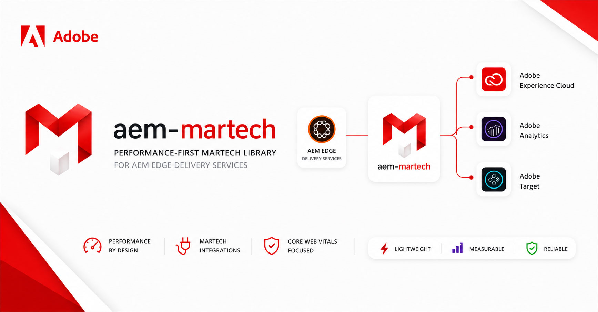

The AEM Marketing Technology plugin helps you quickly set up a complete MarTech stack for your AEM project. It is currently available to customers in collaboration with AEM Engineering via co-innovation VIP Projects. To implement your use cases, please reach out to the AEM Engineering team in the Slack channel dedicated to your project.

## Table of Contents

- [AEM Edge Delivery Services Marketing Technology](#aem-edge-delivery-services-marketing-technology)
  - [Table of Contents](#table-of-contents)
  - [How It Works](#how-it-works)
  - [Features](#features)
  - [Prerequisites](#prerequisites)
    - [Launch Container Configuration](#launch-container-configuration)
  - [Installation](#installation)
  - [Project Instrumentation](#project-instrumentation)
    - [1. Add Preload Hints](#1-add-preload-hints)
    - [2. Import Plugin Methods](#2-import-plugin-methods)
    - [3. Configure the Plugin](#3-configure-the-plugin)
    - [4. Wait for Personalization](#4-wait-for-personalization)
    - [5. Load Lazy Logic](#5-load-lazy-logic)
    - [6. Load Consent-Dependent Logic](#6-load-consent-dependent-logic)
  - [API Reference](#api-reference)
    - [`initMartech(webSDKConfig, martechConfig)`](#initmartechwebsdkconfig-martechconfig)
    - [`updateUserConsent(consent)`](#updateuserconsentconsent)
    - [`pushToDataLayer(payload)`](#pushtodatalayerpayload)
    - [`pushEventToDataLayer(event, xdm, data, configOverrides)`](#pusheventtodatalayerevent-xdm-data-configoverrides)
    - [`sendEvent(payload)`](#sendeventpayload)
    - [`sendAnalyticsEvent(xdmData, dataMapping, configOverrides)`](#sendanalyticseventxdmdata-datamapping-configoverrides)
    - [`initRumTracking(sampleRUM, options)`](#initrumtrackingsamplerum-options)
    - [`isPersonalizationEnabled()`](#ispersonalizationenabled)
  - [Consent Management](#consent-management)
      - [Connecting the Boilerplate Consent Flow](#connecting-the-boilerplate-consent-flow)
      - [Integrating with AEM Consent Banner Block](#integrating-with-aem-consent-banner-block)
      - [Integrating with OneTrust](#integrating-with-onetrust)
      - [Integrating with Cookiebot](#integrating-with-cookiebot)
      - [Verifying Consent Handling](#verifying-consent-handling)
  - [Working with Dynamic Content (SPAs)](#working-with-dynamic-content-spas)
  - [FAQ](#faq)
    - [Why not use the default Adobe Launch approach?](#why-not-use-the-default-adobe-launch-approach)
    - [Can't I just defer the Launch script?](#cant-i-just-defer-the-launch-script)
    - [Why is `git subtree` used for installation?](#why-is-git-subtree-used-for-installation)
    - [What guarantees do I have that this won't break?](#what-guarantees-do-i-have-that-this-wont-break)
    - [What's the catch?](#whats-the-catch)
  - [Dependencies](#dependencies)
  - [Web SDK Configuration](#web-sdk-configuration)
    - [Integration with Adobe Launch](#integration-with-adobe-launch)
    - [Configuration Reference](#configuration-reference)
    - [Example On-Page Configuration](#example-on-page-configuration)

## How It Works

This plugin optimizes the integration of Adobe's marketing technology stack by moving away from a monolithic Adobe Launch script. Instead, it "decomposes" the key components—Adobe Experience Platform WebSDK and Adobe Client Data Layer (ACDL)—and loads them at the optimal time during the page load lifecycle.

This is achieved through a phased approach that aligns with modern web performance best practices:

- **Eager Phase**: Handles personalization during the initial page load when enabled and permitted by the site's consent policy, before the content renders.
- **Lazy Phase**: Loads analytics and the data layer after the main content has rendered. Web SDK collection is governed by the mapped consent state.
- **Consented Loading**: Loads Launch containers and other consent-dependent scripts from `consented.js` once the site's consent check grants the permissions they need. The plugin's hook for loading Launch containers is still named `martechDelayed`.

The boilerplate starts its consent check from `loadDelayed()`. This gate does not prevent eager or lazy libraries from loading, and it does not update Web SDK consent automatically. See [Consent Management](#consent-management) for the site-level wiring.

By instrumenting the core Adobe libraries directly but in a controlled sequence, this plugin minimizes performance impact while retaining the full power of the Adobe Experience Cloud. The AEP Web SDK extension in Launch ([v2.34.0+](https://github.com/adobe/reactor-extension-alloy/releases/tag/v2.34.0)) natively supports this self-hosted approach, so you can extend your implementation with Launch rules, data elements, and event types as usual.

## Features

The AEM MarTech plugin is essentially a wrapper around the Adobe Experience Platform WebSDK and the Adobe Client Data Layer that seamlessly integrates your website with:

- 🎯 Adobe Target or Adobe Journey Optimizer: to personalize your pages
- 📊 Adobe Analytics: to track customer journey data
- 🚩 Adobe Experience Platform Tags (a.k.a. Launch): to track your custom events

Its key differentiators are:
- 🌍 **Experience Platform enabled**: The library fully integrates with our main Adobe Experience Platform and all the services of our ecosystem.
- 🚀 **Extremely fast**: The library is optimized to reduce load delay, TBT, and CLS, and has a minimal impact on your Core Web Vitals.
- 👤 **Privacy-first**: The library does not track end-users by default and can be easily integrated with your preferred consent management system.
- 🔬 **Speculative prerender aware**: The library supports [speculative prerendering](https://developer.mozilla.org/en-US/docs/Web/API/Speculation_Rules_API) and won't fire Analytics events (and artificially inflate your page views) until the page is actually viewed.

## Prerequisites

You need access to:
- **Adobe Experience Platform** (no full license needed, just basic permissions for data collection)
- **Adobe Analytics**
- **Adobe Target** or **Adobe Journey Optimizer**

### Launch Container Configuration

Before instrumenting your project, you must configure your Adobe Experience Platform Tags (Launch) container to use the alloy instance created by this plugin.

1. Open your Launch property and navigate to **Extensions**
2. Install or configure the **Adobe Experience Platform Web SDK** extension (v2.34.0+)
3. Under **Build Options**, select **"Use a self-hosted alloy.js instance"**
4. Set the **Instance name** to `alloy`
5. Save and publish your changes

This tells the extension to hook into the alloy instance managed by this plugin rather than bundling and configuring its own copy. You can then use Launch data elements, rules, and Web SDK event types (like "Send Event Complete") to extend your implementation.

> Requires **v2.34.0 or later** of the AEP Web SDK extension. See [Custom build options and components](https://experienceleague.adobe.com/en/docs/experience-platform/tags/extensions/client/web-sdk/configure/custom-build-components) for more details.

Also ensure you have the `Adobe Client Data Layer` extension configured.

<details>
<summary>Using an older version of the Web SDK extension (prior to v2.34.0)?</summary>

If you cannot upgrade to v2.34.0+, you must **remove** the AEP Web SDK extension from your Launch property to avoid conflicts. To keep Launch rules that depend on Web SDK events, you can either use Direct Call Rules or install the "AA via AEP Web SDK" community extension as a bridge. Upgrading to v2.34.0+ is strongly recommended.
</details>

:warning: **Legal Disclaimer:** This library defaults user consent to `pending`. Setting user consent to `in` overrides this behavior to grant consent by default (i.e. without explicit end user agreement). Customers should consult with their own legal counsel to understand their privacy obligations and the appropriate use and configuration of this library.

We also recommend using a consent management system.

## Installation

We have a comprehensive [tutorial on Experience League](https://experienceleague.adobe.com/en/docs/platform-learn/tutorial-one-adobe/assetmgmt/assetm1/ex5), or you can just follow the steps below.

Add the plugin to your AEM project by running:
```sh
git subtree add --squash --prefix plugins/martech git@github.com:adobe-rnd/aem-martech.git main
```

If you later want to pull the latest changes and update your local copy of the plugin:
```sh
git subtree pull --squash --prefix plugins/martech git@github.com:adobe-rnd/aem-martech.git main
```

If the `subtree pull` command fails, you can delete the `plugins/martech` folder and re-add it using the `git subtree add` command.

If you use a linter, make sure to ignore minified files in your `.eslintignore`:
```
*.min.js
```

## Project Instrumentation

To connect and configure the plugin, you'll need to edit your project's `head.html`, `scripts/scripts.js`, and consent scripts. The examples below follow the [boilerplate consent flow introduced in adobe/aem-boilerplate#653](https://github.com/adobe/aem-boilerplate/pull/653).

This setup retains eager personalization and lazy instrumentation. If your policy prohibits all MarTech library loads or requests before consent, also defer the plugin import, initialization, and lifecycle calls, and omit the early preload and preconnect hints below. That changes when personalization and the initial page view can run.

### 1. Add Preload Hints

Add the following lines at the end of your `head.html` to speed up page load:
```html
<link rel="preload" as="script" crossorigin="anonymous" href="/plugins/martech/src/index.js"/>
<link rel="preload" as="script" crossorigin="anonymous" href="/plugins/martech/src/alloy.min.js"/>
<link rel="preconnect" href="https://edge.adobedc.net"/>
<!-- Change to adobedc.demdex.net if you enable third-party cookies -->
```

### 2. Import Plugin Methods

Import the necessary methods at the top of your `scripts.js` file:
```js
import {
  initMartech,
  updateUserConsent,
  martechEager,
  martechLazy,
} from '../plugins/martech/src/index.js';
```

### 3. Configure the Plugin

Call `initMartech` at the top of the `loadEager` method in your `scripts.js`. This function takes two arguments: the WebSDK configuration and the library-specific configuration.

```js
/**
 * Loads everything needed to get to LCP.
 */
async function loadEager(doc) {
  // Replace with the stored personalization permission from your CMP.
  const isConsentGiven = false;

  const martechLoadedPromise = initMartech(
    // 1. WebSDK Configuration
    // Docs: https://experienceleague.adobe.com/en/docs/experience-platform/web-sdk/commands/configure/overview#configure-js
    {
      datastreamId: /* your datastream id here */,
      orgId: /* your IMS org id here */,
      // The `debugEnabled` flag is automatically set to true on localhost and .page URLs.
      // The `defaultConsent` is automatically set to "pending".
      onBeforeEventSend: (payload) => {
        // This callback allows you to modify the payload before it's sent.
        // Return false to prevent the event from being sent.
      },
      edgeConfigOverrides: {
        // Optional datastream overrides for different environments.
      },
    },
    // 2. Library Configuration
    {
      personalization: !!getMetadata('target') && isConsentGiven,
      launchUrls: [/* your Launch script URLs here */],
      // To request additional decision scopes beyond the default `__view__` scope,
      // list them here. They are added to the eager personalization fetch.
      // decisionScopes: ['my-scope-name'],
      // See the API Reference for all available options.
    },
  );
  // ... rest of loadEager
}
```

Use a known personalization choice during eager initialization. If no permission is available yet, keep personalization disabled and render the default content. Do not wait for the visitor to answer a banner before rendering the page. Moving personalization into `consented.js` is too late to preserve the same pre-render behavior and can introduce visible content changes.

After calling `initMartech`, forward stored consent choices through `updateUserConsent` and subscribe to later CMP changes as described in [Consent Management](#consent-management). When the SDK is not configured yet, that update is queued. Do not block the lifecycle hook that configures the SDK while waiting for the update to complete.

### 4. Wait for Personalization

Adjust your `loadEager` method to wait for the MarTech promise to resolve before rendering the main content. This prevents content flicker from personalized content.

```js
// ... inside loadEager
if (main) {
  decorateMain(main);
  document.body.classList.add('appear');
  await Promise.all([
    martechLoadedPromise.then(martechEager),
    loadSection(main.querySelector('.section'), waitForFirstImage),
  ]);
}
```

### 5. Load Lazy Logic

Add a reference to `martechLazy` just after the `loadFooter(…);` call in your `loadLazy` method:
```js
async function loadLazy(doc) {
  // ...
  loadFooter(doc.querySelector('footer'));
  await martechLazy();
  // ...
}
```

### 6. Load Consent-Dependent Logic

Keep the boilerplate consent check in `scripts/scripts.js`:

```js
function loadDelayed() {
  import('./consent-check.js');
}
```

Load consent-dependent Launch containers from `scripts/consented.js`:

```js
import { martechDelayed } from '../plugins/martech/src/index.js';

await martechDelayed();
```

This reuses the plugin initialized in step 3. Remove any unconditional `martechDelayed()` call from `scripts.js` or the old `delayed.js` to avoid loading containers before consent or loading them twice. Move other consent-dependent code from `delayed.js` into `consented.js`; keep code that does not require consent separate from this gate.

Replace the placeholder in `consent-check.js` with your CMP integration. Apply the relevant Web SDK consent update before importing `consented.js`, and only import it when the visitor has granted the categories required by its tags. See [Connecting the Boilerplate Consent Flow](#connecting-the-boilerplate-consent-flow).

The boilerplate no longer adds a three-second timer here. Consent-dependent scripts can start as soon as the check grants consent during the delayed phase. Consent and performance scheduling are separate concerns.

## API Reference

The plugin exports several functions to interact with the marketing stack.

---

### `initMartech(webSDKConfig, martechConfig)`
Initializes the library. This should be called once in `loadEager`.

- **`webSDKConfig`** `{Object}`: Configuration for the Adobe Experience Platform WebSDK. Requires `datastreamId` and `orgId`.
- **`martechConfig`** `{Object}`: Optional configuration for this library.
  - `analytics` `{Boolean}`: Enable analytics. Default: `true`.
  - `alloyInstanceName` `{String}`: Global name for the alloy instance. Default: `'alloy'`.
  - `dataLayer` `{Boolean}`: Enable Adobe Client Data Layer (ACDL). Default: `true`.
  - `dataLayerInstanceName` `{String}`: Global name for the ACDL instance. Default: `'adobeDataLayer'`.
  - `includeDataLayerState` `{Boolean}`: Include the full data layer state on every event. Default: `true`.
  - `launchUrls` `{String[]}`: Array of Launch script URLs to load.
  - `personalization` `{Boolean}`: Enable personalization. Default: `true`.
  - `performanceOptimized` `{Boolean}`: Use aggressive performance optimizations. Default: `true`.
  - `personalizationTimeout` `{Number}`: Timeout in ms for personalization. Default: `1000`.
  - `trackPageView` `{Boolean}`: Whether to automatically send a page view event on page activation. When `false`, the library sends a `decisioning.propositionDisplay` event instead, so proposition display is still reported to Target without triggering an extra page view. Set to `false` if this is already handled separately in the page. Default: `true`.
  - `shouldProcessEvent` `{Function}`: A function that receives a data layer event payload and returns `false` to prevent it from being sent.
  - `decisionScopes` `{String[]}`: Additional decision scopes to request beyond the default `__view__` scope. Previously this required mutating the payload via `onBeforeEventSend`; this provides a dedicated config field. The scopes are included in both the eager `propositionFetch` (when `performanceOptimized` is `true`) and the `martechLazy` `sendEvent` (when `performanceOptimized` is `false`), with `__view__` always included. Default: `[]`.

---

### `updateUserConsent(consent)`
Sets user consent using the [Adobe standard v2.0](https://experienceleague.adobe.com/en/docs/experience-platform/landing/governance-privacy-security/consent/adobe/dataset) format. If you use a CMP based on IAB TCF 2.0, map its categories to the `collect`/`marketing`/`personalize`/`share` flags as shown in the [Consent Management](#consent-management) examples.

- **`consent`** `{Object}`: An object detailing user consent choices (`collect`, `marketing`, `personalize`, `share`).
- **Returns** `{Promise}`: Resolves once the SDK consent update has completed. If the SDK is not configured yet, the update is queued until configuration completes. Call `initMartech` before this method.

---

### `pushToDataLayer(payload)`
Pushes a generic payload to the Adobe Client Data Layer.

- **`payload`** `{Object}`: The data object to push.

---

### `pushEventToDataLayer(event, xdm, data, configOverrides)`
A helper for pushing a standardized event to the data layer.

- **`event`** `{String}`: The name of the event.
- **`xdm`** `{Object}`: The XDM data object.
- **`data`** `{Object}`: Additional data mappings.
- **`configOverrides`** `{Object}`: Optional Edge configuration overrides.

---

### `sendEvent(payload)`
A proxy for the `alloy('sendEvent', ...)` command to send a raw event.

- **`payload`** `{Object}`: The full event payload for the WebSDK.

---

### `sendAnalyticsEvent(xdmData, dataMapping, configOverrides)`
A helper for sending an analytics event directly.

- **`xdmData`** `{Object}`: The XDM data object.
- **`dataMapping`** `{Object}`: Data mappings for the event.
- **`configOverrides`** `{Object}`: Optional Edge configuration overrides.

---

### `initRumTracking(sampleRUM, options)`
Initializes RUM (Real User Monitoring) tracking.

- **`sampleRUM`** `{Object}`: The RUM sampling object.
- **`options`** `{Object}`: Optional configuration.

---

### `isPersonalizationEnabled()`
- **Returns** `{Boolean}`: `true` if personalization is configured and enabled.

---

## Consent Management

Connect your consent management platform (CMP) to `updateUserConsent`. Map its categories to `collect`, `marketing`, `personalize`, and `share`. Read stored choices on page load and forward later changes, including withdrawal. Do not turn a single analytics opt-in into permission for every category.

The Web SDK defaults to `pending`. That setting controls SDK event handling; it does not prevent the SDK library from loading. SDK consent also does not control every third-party script a Launch container may load. Review the container's tags and their required permissions separately.

#### Connecting the Boilerplate Consent Flow

The boilerplate's `consent-check.js` dispatches a `consent.update` event with `detail: { consented: boolean }` and imports `consented.js` only when that boolean is true. The supplied check declines by default. It evaluates the choice once when imported and does not subscribe to a real CMP.

Neither the plugin nor `updateUserConsent` listens for `consent.update` automatically. Your site must connect the CMP to both the SDK consent update and the script-loading decision:

1. Register CMP listeners before the initial check runs. Retain the current choices so plugins initialized later receive them too.
2. After `initMartech`, map the choices to the plugin's consent fields and call `updateUserConsent`. Let the eager and lazy hooks configure the SDK so queued updates can complete.
3. Before loading consent-dependent Launch containers, wait for the relevant SDK consent update to complete and check the categories those containers require. Split scripts into separate loaders when their permissions differ.
4. On subsequent changes, update the SDK again and load newly permitted scripts only once. On withdrawal, also apply the CMP/vendor-specific stop or cleanup behavior for tags already loaded.

An asynchronous event listener alone does not enforce this ordering: `dispatchEvent()` does not wait for promises returned by listeners. Coordinate the SDK update and dependent import explicitly in your site's CMP adapter.

The boolean `consented` is a loading decision, not a replacement for granular consent categories. The boilerplate's one-time import guard prevents repeated execution of `consented.js`; it does not unload scripts or stop their activity after withdrawal.

Use `?consent=accept` and `?consent=decline` only to exercise the boilerplate placeholder during development. Do not retain the query-string override as a production consent mechanism.

Replace the boilerplate's `scripts/consent-check.js` with the shared code below, then append **one** of the provider adapters in the following sections to that same file. Keep `loadDelayed()` and `consented.js` as shown in [step 6](#6-load-consent-dependent-logic). Load the CMP itself independently of `consented.js`; otherwise it cannot ask for consent.

These examples assume `initMartech()` and `martechLazy()` have already run before `loadDelayed()`. They read the provider's current state after registering listeners, so a returning visitor's choice is not lost if the provider emitted its initial event earlier. Until a provider supplies a choice, the SDK remains pending and the consented entry point stays unloaded.

```js
// scripts/consent-check.js
import { updateUserConsent } from '../plugins/martech/src/index.js';

let latestRevision = 0;
let pendingUpdate = Promise.resolve();

function onConsentUpdate(consent) {
  const revision = ++latestRevision;
  pendingUpdate = pendingUpdate.then(async () => {
    if (revision !== latestRevision) return;
    await updateUserConsent(consent);
    if (revision !== latestRevision) return;

    // Example policy: this Launch container requires analytics and marketing consent.
    const consented = consent.collect && consent.marketing;
    window.dispatchEvent(new CustomEvent('consent.update', { detail: { consented } }));
    if (consented && revision === latestRevision) {
      await import('./consented.js');
    }
  }).catch((error) => {
    console.error('Could not apply consent or load consented scripts', error);
  });
}

// Append one provider adapter below.
```

Change the `consented` condition to match every tag loaded by your `consented.js`. The mappings below are examples, not a universal mapping between cookie categories and Adobe consent purposes. In particular, permission for advertising cookies does not necessarily grant permission for marketing communications or data sharing. Review these mappings with your privacy team.

The update queue preserves SDK update order and skips superseded choices before starting a new import. Repeated grants reuse the browser's cached ES module, so `consented.js` executes once per page. A withdrawal cannot cancel an import already in progress or unload a running tag. Use `consent.update` to connect any vendor-specific stop or cleanup logic, and handle later grants if that vendor needs to be restarted.

The `.catch()` reports SDK or loading failures without loading dependent scripts after a failed SDK update. Later CMP notifications can still be processed. An import that has already failed evaluation may require a page reload.

#### Integrating with AEM Consent Banner Block

For sites using the example [AEM Consent Banner Block from adobe/aem-block-collection#50](https://github.com/adobe/aem-block-collection/pull/50), append this adapter to `scripts/consent-check.js`:

```js
function readAemConsent() {
  const categories = window.consent?.categories;
  if (!Array.isArray(categories)) return;

  onConsentUpdate({
    collect: categories.includes('CC_ANALYTICS'),
    marketing: categories.includes('CC_MARKETING'),
    personalize: categories.includes('CC_TARGETING'),
    share: categories.includes('CC_SHARING'),
  });
}

window.addEventListener('consent', readAemConsent);
window.addEventListener('consent-updated', readAemConsent);
readAemConsent();
```

Initialize the banner separately using its documented setup. The referenced block writes both stored choices and subsequent changes to `window.consent.categories` before emitting its events. Reading that snapshot avoids depending on an event payload and also handles a choice read before `consent-check.js` loads. Category codes come from your banner configuration.

The linked block is an example in a closed, unmerged PR. Confirm the snapshot and event API of the version installed in your site before using this adapter.

#### Integrating with OneTrust

Install your OneTrust CMP script independently of the Launch container, then append this adapter to `scripts/consent-check.js`. It uses the documented [`OneTrustGroupsUpdated` event](https://developer.onetrust.com/onetrust/docs/javascript-events-guide), which fires on initialization and when preferences change:

```js
function applyOneTrustGroups(groups) {
  onConsentUpdate({
    collect: groups.includes('C0002'),
    marketing: groups.includes('C0004'),
    personalize: groups.includes('C0003'),
    share: false,
  });
}

window.addEventListener('OneTrustGroupsUpdated', (event) => {
  applyOneTrustGroups(event.detail);
});

if (typeof window.OnetrustActiveGroups === 'string') {
  applyOneTrustGroups(window.OnetrustActiveGroups.split(',').filter(Boolean));
}
```

The snapshot handles OneTrust loading before this module; the listener handles OneTrust loading later and subsequent changes. Verify group IDs and their meaning in your OneTrust configuration. The example uses `C0002` for analytics, `C0003` for personalization, and `C0004` for marketing. Sharing remains denied until you map a separate applicable choice.

OneTrust can mark groups as always active or apply regional defaults. If your policy requires an explicit response, include that requirement in the adapter before granting the corresponding permissions.

#### Integrating with Cookiebot

Install the Cookiebot CMP script independently of the Launch container, then append this adapter to `scripts/consent-check.js`. Cookiebot documents its current state and events in its [developer reference](https://www.cookiebot.com/en/developer/):

```js
function readCookiebotConsent() {
  const provider = window.Cookiebot;
  if (!provider?.consent) return;

  const hasResponse = provider.hasResponse === true;
  onConsentUpdate({
    collect: hasResponse && provider.consent.statistics === true,
    marketing: hasResponse && provider.consent.marketing === true,
    personalize: hasResponse && provider.consent.preferences === true,
    share: false,
  });
}

window.addEventListener('CookiebotOnConsentReady', readCookiebotConsent);
window.addEventListener('CookiebotOnAccept', readCookiebotConsent);
window.addEventListener('CookiebotOnDecline', readCookiebotConsent);
readCookiebotConsent();
```

`CookiebotOnConsentReady` covers stored choices and newly submitted choices. The accept and decline listeners also re-read the current state; repeated notifications are safe. The initial read handles Cookiebot becoming ready before this module loads. With no response, this example denies the mapped permissions. Sharing remains denied until you map a separate applicable choice.

If your site calls `Cookiebot.withdraw()` programmatically, call `readCookiebotConsent()` after withdrawing as well. This forwards the cleared state even if that operation does not emit one of the events above.

#### Verifying Consent Handling

Clear stored consent between fresh-visitor tests. Check eager/lazy requests separately from the consented entry point.

| Scenario | Expected result |
| --- | --- |
| No choice or explicit decline | `consented.js` and its Launch containers do not load. Eager/lazy behavior matches the site's consent policy. |
| Stored consent | The applicable SDK consent update completes before dependent tags start. |
| Consent granted after page load | The CMP adapter forwards the update and loads newly permitted scripts without blocking page rendering or requiring a reload. |
| Only some categories granted | Only scripts covered by those permissions load; other categories remain denied. |
| Repeated grant notification | The consented entry point does not execute again and containers are not loaded twice. |
| Consent withdrawn | The SDK receives the updated choices and the site applies the required vendor-specific stop or cleanup behavior. |

If tags stop loading after a boilerplate upgrade, check that the CMP is connected to `consent-check.js`, that it grants the required permissions, and that your consent-dependent entry point is now `consented.js`. The placeholder declines by default. Also check for consent events emitted before listeners were registered.

## Working with Dynamic Content (SPAs)

For Single Page Applications or pages with dynamic content, you may need to manage personalization manually to avoid concurrency issues.

1.  **Follow the SPA approach** and define [views in Adobe Target](https://experienceleague.adobe.com/en/docs/target/using/experiences/spa-visual-experience-composer).
2.  **Import the helper methods** in your components:
    ```js
    import {
      isPersonalizationEnabled,
      getPersonalizationForView,
      applyPersonalization,
    } from '../plugins/martech/src/index.js';
    ```
3.  **Fetch the personalization** for the view when it renders:
    ```js
    if (isPersonalizationEnabled()) {
      await getPersonalizationForView('my-view-name');
    }
    ```
4.  **Apply the personalization** every time there is a significant DOM update:
    ```js
    applyPersonalization('my-view-name');
    ```

## FAQ

### Why not use the default Adobe Launch approach?
A default Launch implementation can negatively impact Core Web Vitals. Our approach optimizes for performance by loading components intelligently.

### Can't I just defer the Launch script?
Deferring the entire script introduces content flickering for personalization use cases and can lead to missed analytics events from users who bounce early.

### Why is `git subtree` used for installation?
`git subtree` is used to vendor the plugin's code directly into your project. This approach avoids the need for a package manager like `npm` and the complexities of `git submodule`, providing a simple way to pull in updates while keeping the code self-contained within your repository.

### What guarantees do I have that this won't break?
This library uses the same official Adobe Experience Platform WebSDK and Adobe Client Data Layer as Launch. We are building on documented Adobe APIs, such as [top and bottom of page events](https://experienceleague.adobe.com/en/docs/experience-platform/web-sdk/use-cases/top-bottom-page-events), to ensure compatibility.

### What's the catch?
SDK initialization and configuration live in your project's code rather than the Launch UI. This is by design — it's what enables the phased loading that keeps your Core Web Vitals fast. With the AEP Web SDK extension (v2.34.0+) configured to use the self-hosted instance, you retain full access to Launch data elements, rules, and event types to extend your implementation.

## Dependencies

This plugin includes the following core libraries:
- **Adobe Experience Platform WebSDK**: `v2.31.1` (`alloy.min.js`)
- **Adobe Client Data Layer**: `v3.0.1` (`acdl.min.js`)

To update the vendored copies from Adobe's official distribution channels (the WebSDK
self-hosting CDN and the ACDL npm package), and keep the version numbers above in sync, run:
```sh
npm run update:vendor               # latest published versions
npm run update:vendor -- 2.31.1 3.0.1  # or specific versions
```

## Web SDK Configuration

This project manages the on-page, self-hosted implementation of the Adobe Experience Platform Web SDK (`alloy.js`).

### Integration with Adobe Launch

As of [v2.34.0](https://github.com/adobe/reactor-extension-alloy/releases/tag/v2.34.0), the AEP Web SDK extension officially supports self-hosted alloy instances. When configured as described in the [Launch Container Configuration](#launch-container-configuration) section above, the extension hooks into the alloy instance created by this plugin. This means:

- The Launch library will not bundle a second copy of alloy.js
- The Launch library will not attempt to re-configure the SDK
- Launch data elements and rules that reference the Web SDK work normally
- Web SDK event types (like "Send Event Complete") work normally in your rules

All SDK configuration (Datastream ID, Org ID, Default Consent, etc.) is managed through this project's code as shown in the Configuration Reference section below.

### Configuration Reference

All configuration is set within the `alloy("configure", { ... })` command. For a complete and official reference of all available options, please see the Adobe Experience League documentation, which is the source of truth.

*   **Primary Documentation: [Configuring the Web SDK](https://experienceleague.adobe.com/en/docs/experience-platform/web-sdk/commands/configure/index.html)**

The table below summarizes the most common settings that are now managed here instead of in the Launch UI, with direct links to their respective documentation pages.

| Option | Description | Example Value |
| :--- | :--- | :--- |
| [`datastreamId`](https://experienceleague.adobe.com/en/docs/experience-platform/web-sdk/commands/configure/datastreamid) | The ID of the datastream to send data to. | `'YOUR_DATASTREAM_ID'` |
| [`orgId`](https://experienceleague.adobe.com/en/docs/experience-platform/web-sdk/commands/configure/orgid) | Your Experience Cloud Organization ID. | `'YOUR_ORG_ID@AdobeOrg'` |
| [`edgeDomain`](https://experienceleague.adobe.com/en/docs/experience-platform/web-sdk/commands/configure/edgedomain) | The first-party domain (CNAME) for interacting with Adobe services. | `'edge.your-domain.com'` |
| [`defaultConsent`](https://experienceleague.adobe.com/en/docs/experience-platform/web-sdk/commands/configure/defaultconsent) | The default consent level (`in`, `out`, or `pending`). | `'pending'` |
| [`idMigrationEnabled`](https://experienceleague.adobe.com/en/docs/experience-platform/web-sdk/commands/configure/idmigrationenabled) | Enables migration of visitor IDs from legacy Adobe libraries. | `true` |
| [`targetMigrationEnabled`](https://experienceleague.adobe.com/en/docs/experience-platform/web-sdk/identity/id-migration/target-visitor-id) | Ensures visitor profile is maintained when migrating from `at.js`. | `true` |
| [`onBeforeEventSend`](https://experienceleague.adobe.com/en/docs/experience-platform/web-sdk/commands/configure/onbeforeeventsend) | A callback function to modify event data before it's sent. | `(options) => { /* logic */ }` |

### Example On-Page Configuration

Here is an example of how you might configure the SDK in your script:

```javascript
alloy("configure", {
  // --- Required ---
  datastreamId: "xxxxxxxx-xxxx-xxxx-xxxx-xxxxxxxxxxxx",
  orgId: "XXXXXXXXXXXXXXX@AdobeOrg",

  // --- Recommended ---
  edgeDomain: "edge.your-site.com",
  defaultConsent: "pending",

  // --- Optional: Migration & Callbacks ---
  idMigrationEnabled: true,
  targetMigrationEnabled: true,
  onBeforeEventSend: function(options) {
    // This callback allows for last-minute modification
    // of the XDM payload before it is sent.
    // For example, adding a custom context:
    options.xdm.customContext = "some value";
  }
});
``` 
